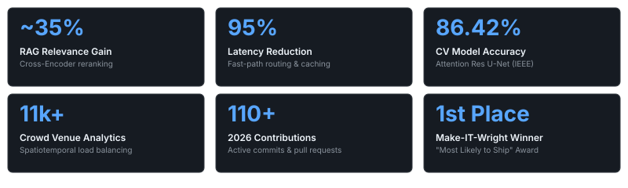

# Rishindra Mateti

AI/ML researcher and engineer building reliable, evidence-aware systems. I work where research methods meet practical software: computer vision, privacy-preserving machine learning, retrieval systems, and AI evaluation.

| Research | Engineering |
| --- | --- |
| Papers, benchmarks, and reproducible experiments on trustworthy AI systems. | Applied systems and developer tools designed to make AI useful in the real world. |
| [Explore research →](https://research.rishindramateti.com/) | [Explore engineering work →](https://www.rishindramateti.com) |

## Research

- **LLM reliability & evaluation** — benchmarks for schema complexity, tool calling, and evidence-grounded retrieval.
- **Computer vision** — peer-reviewed work on attention-based semantic segmentation for high-resolution aerial imagery.
- **Privacy-preserving ML** — differential privacy mechanisms, sensitivity calibration, and privacy–utility trade-offs.

Selected work: [IEEE ESCI 2024 publication](https://doi.org/10.1109/ESCI59607.2024.10497287) · [Cross-substance ML technical report](https://doi.org/10.5281/zenodo.23166995) · [Semantic Segmentation repository](https://github.com/rishindra-mateti-tech/Semantic_Segmentation)

## Engineering

- **AI systems** — retrieval pipelines, multi-agent workflows, and evaluation-oriented developer tooling.
- **ML infrastructure** — reproducible experimentation, Python services, and production-minded deployment.
- **Open-source projects** — tools, prototypes, and research implementations with documentation and runnable code.

Selected work: [CodeStory](https://codestory-dev.vercel.app) · [Contract Fragility benchmark](https://github.com/rishindra-mateti-tech/contract-fragility-schema-complexity-benchmark) · [networKING.agent](https://networking-s-agent.vercel.app)

## Connect

[Research portfolio](https://research.rishindramateti.com/) · [Engineering portfolio](https://www.rishindramateti.com) · [ORCID](https://orcid.org/0009-0009-5880-8727) · [Email](mailto:contact@rishindramateti.com)

---

  

